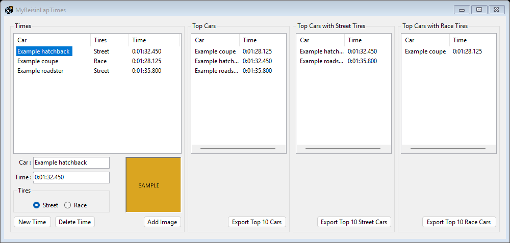

# 🏁 MyReisinLapTimes


[](LICENSE)
[](https://github.com/Evilchuck666/MyReisinLapTimes/releases/latest)
[](https://github.com/Evilchuck666/MyReisinLapTimes/actions/workflows/release.yaml)

**Keep your car lap times, rank them and export shareable Top 10 images.**

MyReisinLapTimes is a small Windows desktop app for logging lap times of
different cars. Every time is stored with the car's name, a photo and the type
of tires it ran on, and the app keeps three live leaderboards: overall, street
tires and race tires. Each leaderboard can be exported as a poster-style
Top 10 image, ready to share.

🌐 **Website:** https://evilchuck666.github.io/MyReisinLapTimes/

<!-- SCREENSHOTS:START -->
## 📸 Screenshots



MyReisinLapTimes main window.

<!-- SCREENSHOTS:END -->

## ✨ Features

- Add a lap time with the car's name, its time (`h:mm:ss.fff`), the tire type
  (**Street** or **Race**) and a photo.
- Delete a time by selecting it in the list.
- Click a time to see its car, tires and photo again.
- Shows three rankings sorted from fastest to slowest:
  - **Top Cars**: every time.
  - **Top Cars with Street Tires**.
  - **Top Cars with Race Tires**.
- Exports any of the three rankings as a 2700 × 2700 PNG with the ten fastest
  cars, their photos and their times, and opens it straight away.
- Saves everything automatically.

## 📥 Download

| Platform | Latest stable release |
| --- | --- |
| Windows x64 | [Download](https://github.com/Evilchuck666/MyReisinLapTimes/releases/latest/download/MyReisinLapTimes-windows-x64.exe) |

[Release notes](https://github.com/Evilchuck666/MyReisinLapTimes/releases/latest) · [SHA256SUMS.txt](https://github.com/Evilchuck666/MyReisinLapTimes/releases/latest/download/SHA256SUMS.txt)

## 🚀 Getting started

1. Download **MyReisinLapTimes-windows-x64.exe** from the table above.
2. Run it from anywhere. It is a single self-contained file, so you do not
   need to install .NET.
3. Type the car's name and its lap time, pick the tires, press **Add Image** to
   choose a photo and press **New Time**.
4. Use the **Export Top 10** buttons to create the ranking images.

## 💾 Where your data lives

Everything is stored in `%LOCALAPPDATA%\MyReisin`:

| File | Contents |
| --- | --- |
| `data.json` | Every car and lap time, with its photo embedded (base64 PNG, scaled to 200 × 200). |
| `Top10.png`, `Top10Street.png`, `Top10Race.png` | The last exported ranking images. |

Back up `data.json` to keep your times.

## 📚 Learn more

To build from source you need Windows and the [.NET 10 SDK](https://dotnet.microsoft.com/download/dotnet/10.0):

```powershell
dotnet run
```

- [Technical guide](TECHNICAL_GUIDE.md): export assets, building the release
  executable, releases and project layout.

The title font is [Racing Sans One](https://fonts.google.com/specimen/Racing+Sans+One),
licensed under the [SIL Open Font License 1.1](assets/Racing-OFL.txt).

## ⚖️ License

MyReisinLapTimes is free software released under the **GNU General Public License v3.0** (GPL-3.0). See [LICENSE](LICENSE).
